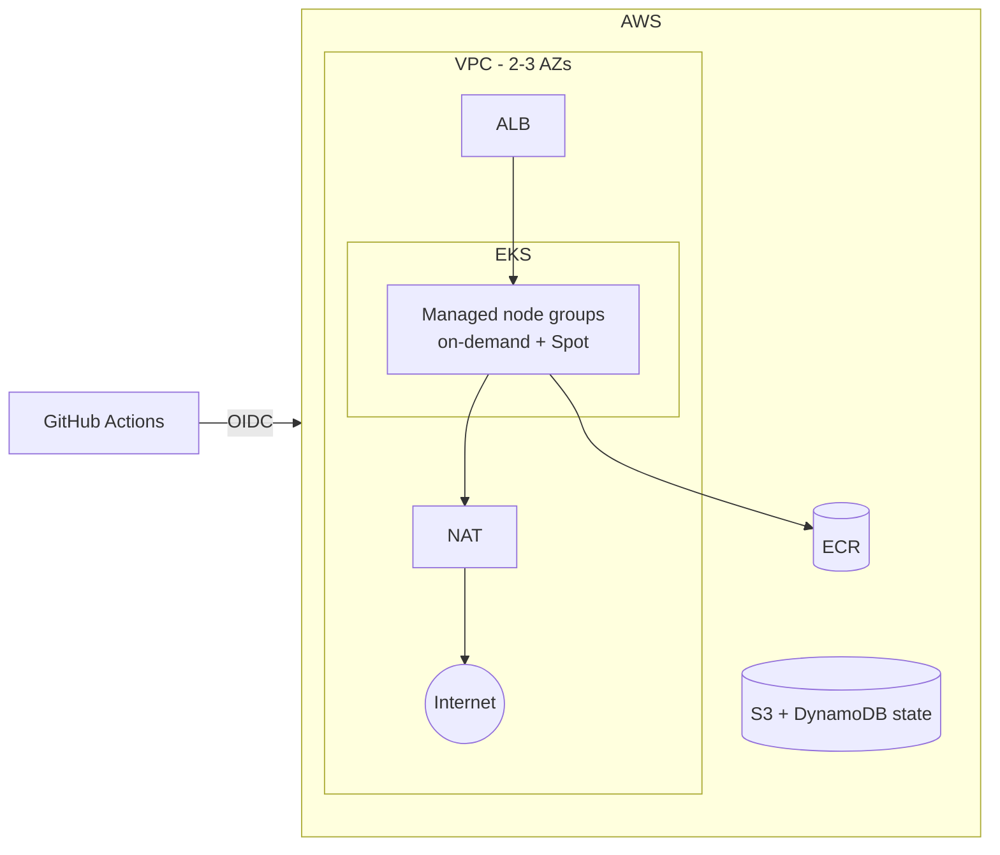

# terraform-aws-eks-platform

Production-ready **Amazon EKS** platform built from scratch with **Terraform**: a multi-AZ VPC, a hardened EKS cluster, managed node groups (on-demand + Spot), ECR, and the core cluster add-ons, all deployed through **GitHub Actions with keyless OIDC authentication**.

Separate `dev` and `prod` environments share the same modules: dev is tuned for cost, prod for availability.


---

## What this solves

Teams often start with an EKS cluster clicked together in the console. A few months later nobody knows how it's configured, dev and prod have drifted apart, and upgrades are frightening. This repo turns the whole platform into reviewed, repeatable code:

- **Reproducible**: one command builds an identical environment in any account or region.
- **Secure by default**: private nodes, encrypted secrets, IMDSv2, least-privilege IAM per component, no static cloud credentials in CI.
- **Cost-aware**: Spot capacity, a single NAT gateway in dev, an S3 endpoint to cut NAT data charges, ECR lifecycle rules, and autoscaling that removes idle nodes.
- **Safe to change**: every PR gets formatting, validation, linting, a security scan and a Terraform plan posted as a comment; prod applies need manual approval.

## Architecture



The full diagram and the reasoning behind each design decision are in [docs/architecture.md](docs/architecture.md).

## What gets built

| Layer | Resources |
|---|---|
| **Networking** ([`modules/vpc`](modules/vpc)) | VPC, public and private subnets across 2-3 AZs, internet gateway, NAT gateway(s), route tables, S3 gateway endpoint, optional VPC flow logs, locked-down default security group, subnet tags for load balancer discovery |
| **Cluster** ([`modules/eks`](modules/eks)) | EKS control plane with KMS-encrypted secrets, control plane logging, EKS access entries, IAM OIDC provider, managed node groups with launch templates (IMDSv2, encrypted gp3), managed add-ons: VPC CNI (prefix delegation), CoreDNS, kube-proxy, EBS CSI driver |
| **Add-ons** ([`modules/addons`](modules/addons)) | metrics-server, AWS Load Balancer Controller, Cluster Autoscaler, each installed with Helm and given its own IRSA role |
| **Registry** ([`modules/ecr`](modules/ecr)) | ECR repositories with scan-on-push, immutable tags, KMS encryption and lifecycle cleanup |
| **IAM** ([`modules/irsa`](modules/irsa)) | Reusable module for IAM Roles for Service Accounts |
| **State** ([`bootstrap`](bootstrap)) | Versioned, encrypted S3 bucket and DynamoDB lock table |
| **CI/CD** ([`.github/workflows`](.github/workflows/terraform.yml)) | fmt, validate, tflint, Trivy IaC scan, plan-as-PR-comment, ordered apply (dev, then prod with approval) |

## Environments

| | `dev` | `prod` |
|---|---|---|
| Availability zones | 2 | 3 |
| NAT gateways | 1 (shared) | 3 (one per AZ) |
| Node groups | `general`: Spot, 1-4 nodes | `system`: on-demand, 3-6 nodes<br/>`spot`: Spot with taint, 0-10 nodes |
| VPC flow logs | off | on |
| ECR force delete | yes | no |

## Repository layout

```
.
├── bootstrap/            # one-time: S3 state bucket + DynamoDB lock table
├── modules/
│   ├── vpc/              # networking
│   ├── eks/              # cluster, node groups, managed add-ons, OIDC
│   ├── addons/           # Helm-installed controllers (+ IRSA roles)
│   ├── ecr/              # container registries
│   └── irsa/             # reusable IAM-role-for-service-account module
├── environments/
│   ├── dev/              # cost-optimised
│   └── prod/             # highly available
├── examples/sample-app/  # smoke-test workload (ALB ingress, HPA, PDB)
├── docs/architecture.md  # full diagram + design decisions
└── .github/workflows/    # CI/CD pipeline
```

## Quick start

**Prerequisites:** Terraform >= 1.6, AWS CLI v2 configured with admin access to a sandbox account, `kubectl`.

```bash
# 1. One-time: create the remote state backend
cd bootstrap
terraform init && terraform apply
# note the "state_bucket" output, e.g. eks-platform-tfstate-123456789012

# 2. Point the environment at your state bucket and allow your IP
cd ../environments/dev
#    - backend.tf:       replace ACCOUNT_ID in the bucket name
#    - terraform.tfvars: set endpoint_public_access_cidrs to ["<your-ip>/32"]

# 3. Build the platform (~15-20 minutes)
terraform init
terraform plan -out=tfplan
terraform apply tfplan

# 4. Connect and smoke-test
$(terraform output -raw configure_kubectl)
kubectl get nodes -L capacity-type,node-group
kubectl apply -f ../../examples/sample-app/app.yaml
kubectl -n sample-app get ingress sample-app -w   # open the ALB address in a browser
```

Or use the Makefile: `make bootstrap`, then `make plan ENV=dev` and `make apply ENV=dev`.

**Tear down** (important for a sandbox, as EKS and NAT bill by the hour):

```bash
kubectl delete -f ../../examples/sample-app/app.yaml   # removes the ALB first
terraform destroy
```

## CI/CD setup

The pipeline authenticates to AWS with **GitHub OIDC**, so no access keys are stored in GitHub.

1. Create an IAM OIDC identity provider for `token.actions.githubusercontent.com` and an IAM role that trusts this repository (scope the trust policy to `repo:<owner>/terraform-aws-eks-platform:*`).
2. Add the role ARN as a repository **variable** named `AWS_ROLE_ARN`.
3. Add the same role ARN to `admin_principal_arns` in each environment's `terraform.tfvars` so CI can manage the Helm add-ons.
4. Create GitHub environments `dev` and `prod`, and add **required reviewers** to `prod`.

Until `AWS_ROLE_ARN` is set, the pipeline still runs every static check (fmt, validate, tflint, Trivy) on each PR.

## Cost estimate (dev)

Rough monthly figures for `ap-south-1`. Check the [AWS Pricing Calculator](https://calculator.aws/) for your region and usage.

| Item | Approx. / month |
|---|---|
| EKS control plane ($0.10/hour) | ~$73 |
| 1 NAT gateway + light data | ~$35-50 |
| 2 x t3.large-class Spot nodes | ~$30-50 |
| ECR, CloudWatch logs, EBS | ~$5-15 |
| **Total** | **~$145-190** |

Prod costs more: 3 NAT gateways, 3+ on-demand nodes and flow logs. Destroy dev when you're not using it.

## Security highlights

- Worker nodes have no public IPs; SSH is disabled and SSM Session Manager is used instead.
- Kubernetes Secrets are envelope-encrypted with a customer-managed, auto-rotating KMS key.
- The API endpoint is private, plus an optional public endpoint restricted to allow-listed CIDRs.
- Access is granted through EKS access entries rather than the `aws-auth` ConfigMap.
- IMDSv2 is enforced on every node.
- Every controller has its own IRSA role scoped to its service account; Cluster Autoscaler can only scale ASGs tagged as owned by this cluster.
- ECR uses immutable tags, scans every pushed image for vulnerabilities, and encrypts with KMS.
- State is stored in an encrypted, versioned, non-public S3 bucket with locking.
- CI scans every change with Trivy; accepted findings are documented with reasons in [`.trivyignore`](.trivyignore).

## Upgrading Kubernetes

1. Bump `cluster_version` in `environments/dev/terraform.tfvars` by one minor version (EKS upgrades one minor version at a time).
2. Check the Helm chart versions in `modules/addons/variables.tf`. The Cluster Autoscaler image should match the cluster's minor version.
3. Run `terraform apply` on dev. The control plane upgrades first, then node groups roll according to their `update_config`.
4. Verify workloads, then repeat for prod.

## Next steps

- [ ] Karpenter as an alternative to Cluster Autoscaler (the private subnets already carry `karpenter.sh/discovery` tags)
- [ ] ArgoCD for GitOps application delivery
- [ ] External Secrets Operator backed by AWS Secrets Manager
- [ ] kube-prometheus-stack for monitoring (see my companion observability repo)

## Author

**Sharanabasava Shettar**: DevOps Engineer | CKA, CKAD

I build and automate Kubernetes platforms on AWS, Azure and GCP.
[LinkedIn](https://www.linkedin.com/in/sharanabasava-shettar)

## License

[MIT](LICENSE)


##end