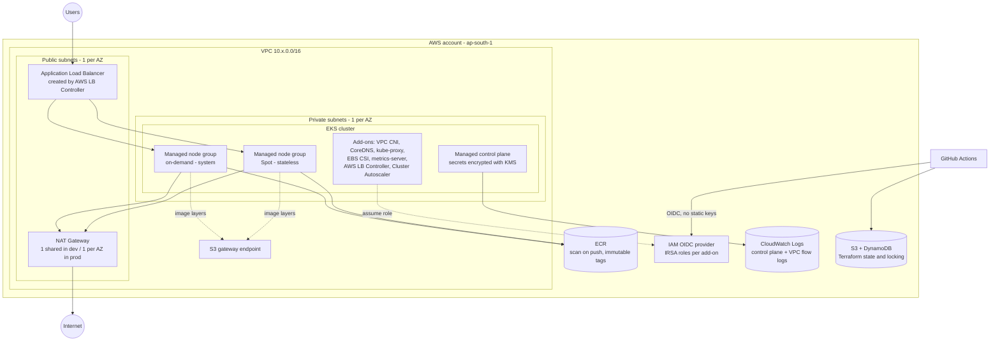

# Architecture

## Design decisions

| Decision | Why |
|---|---|
| Nodes only in private subnets | Nothing on a node is reachable from the internet; traffic enters through the ALB. |
| One NAT in dev, one per AZ in prod | Dev saves roughly $30-60/month per avoided NAT gateway; prod survives the loss of an AZ. |
| S3 gateway endpoint | Free. ECR stores image layers in S3, so pulls skip the NAT and its per-GB charge. |
| EKS access entries (`API` mode) | Replaces the fragile `aws-auth` ConfigMap; access is managed through AWS APIs and Terraform. |
| IRSA per add-on | Each controller gets only the AWS permissions it needs, scoped to its own service account. |
| KMS envelope encryption for Secrets | Kubernetes Secrets are encrypted at rest with a key you control and can rotate. |
| IMDSv2 required, hop limit 2 | Blocks SSRF-style credential theft from the instance metadata service. |
| VPC CNI prefix delegation | Many more pods per node, so fewer, better-utilised nodes. |
| Spot node group with a taint | Only workloads that tolerate interruption land on Spot, for up to ~70% compute savings. |
| `desired_size` ignored by Terraform | Cluster Autoscaler owns node counts at runtime; Terraform won't fight it. |
| Pinned provider and Helm chart versions | Upgrades are deliberate and tested in dev first. |
